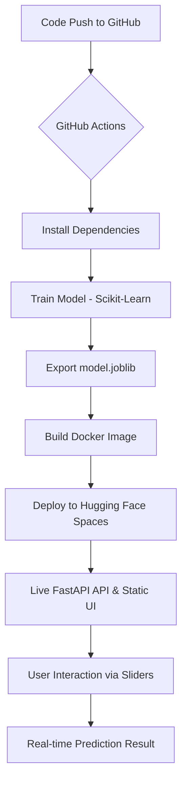

# 🚀 Automated ML Deployment System

[](https://github.com/SadeepSachintha/Automated-ML-Deployment-System/actions/workflows/main.yml)
[](https://huggingface.co/spaces/dwssp/ml-auto-deployment)
[](https://www.python.org/downloads/release/python-3100/)
[](https://opensource.org/licenses/MIT)

A production-grade, fully automated end-to-end Machine Learning operations (MLOps) pipeline. This system automates the entire lifecycle of a model—from training to containerized deployment—ensuring that every code change triggers a fresh model iteration and a seamless update to a **Premium Interactive Dashboard** on **Hugging Face Spaces**.

## ✨ Key Features
- **🎨 Premium Interactive UI**: A modern, glassmorphism-inspired dashboard for real-time model interaction.
- **🔄 Full CI/CD Pipeline**: Automated training and deployment via GitHub Actions.
- **🧠 Auto-Training**: Automatically retrains the Random Forest model on every push to `main`.
- **🐳 Containerized Serving**: Uses Docker for consistent environments across development and production.
- **⚡ Real-time Predictions**: Instant feedback as you adjust feature sliders on the web interface.
- **☁️ Serverless Deployment**: Optimized for cost and performance on Hugging Face Spaces.

## 🏗️ Architecture Overview



## 🛠️ Tech Stack
| Category | Technology |
| :--- | :--- |
| **Language** | Python 3.10 |
| **ML Framework** | Scikit-Learn, Pandas |
| **Frontend** | Vanilla HTML5, CSS3 (Glassmorphism), JavaScript (ES6+) |
| **API Framework** | FastAPI, Uvicorn |
| **CI/CD** | GitHub Actions |
| **Containerization** | Docker |
| **Hosting** | Hugging Face Spaces |

## 🚀 Quick Start

### Local Development
To run this project locally:

1. **Clone & Setup:**
   ```bash
   git clone https://github.com/SadeepSachintha/Automated-ML-Deployment-System.git
   cd "Automated ML Deployment System"
   python -m venv venv
   source venv/bin/activate  # venv\Scripts\activate on Windows
   ```

2. **Install & Train:**
   ```bash
   pip install -r model/requirements.txt
   pip install -r app/requirements.txt
   python model/train.py
   ```

3. **Launch Dashboard:**
   ```bash
   uvicorn app.main:app --reload --port 8000
   ```
   Visit `http://localhost:8000` to see the interactive UI.

## 📡 API Documentation

While the primary interaction is via the web UI, the underlying API is fully accessible:

- **Health Check**: `GET /health`
- **Prediction**: `POST /predict`
  ```json
  {
    "sepal_length": 5.1, "sepal_width": 3.5,
    "petal_length": 1.4, "petal_width": 0.2
  }
  ```

## 📂 Project Structure
- `app/`: FastAPI application and serving logic.
  - `static/`: **[NEW]** Premium frontend assets (HTML/CSS/JS).
  - `model_data/`: Serialized model binaries.
- `model/`: Training scripts and model definitions.
- `.github/workflows/`: CI/CD pipeline definitions.
- `k8s/`: Kubernetes manifests (Legacy AWS EKS config).
- `Dockerfile`: Production container configuration.

## 📝 License
MIT License - see the [LICENSE](LICENSE) file for details.