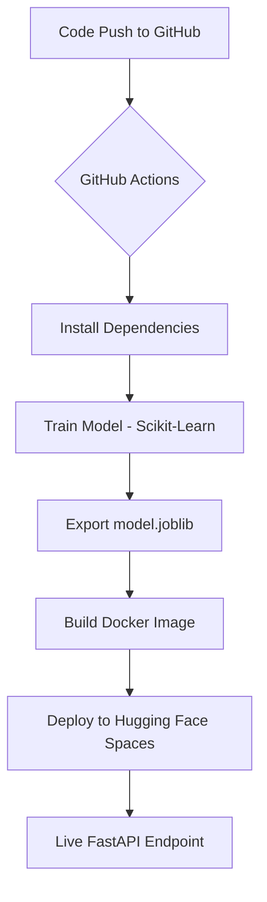

# 🚀 Automated ML Deployment System

[](https://github.com/SadeepSachintha/Automated-ML-Deployment-System/actions/workflows/main.yml)
[](https://huggingface.co/spaces/dwssp/ml-auto-deployment)
[](https://www.python.org/downloads/release/python-3100/)
[](https://opensource.org/licenses/MIT)

A production-grade, fully automated end-to-end Machine Learning operations (MLOps) pipeline. This system automates the entire lifecycle of a model—from training to containerized deployment—ensuring that every code change triggers a fresh model iteration and a seamless update to **Hugging Face Spaces**.

## ✨ Key Features
- **🔄 Full CI/CD Pipeline**: Automated training and deployment via GitHub Actions.
- **🧠 Auto-Training**: Automatically retrains the Random Forest model on every push to `main`.
- **🐳 Containerized Serving**: Uses Docker for consistent environments across development and production.
- **⚡ High-Performance API**: Served using FastAPI with asynchronous endpoints.
- **☁️ Serverless Deployment**: Migrated from complex AWS EKS to cost-effective Hugging Face Spaces.

## 🏗️ Architecture Overview



## 🛠️ Tech Stack
| Category | Technology |
| :--- | :--- |
| **Language** | Python 3.10 |
| **ML Framework** | Scikit-Learn, Pandas |
| **API Framework** | FastAPI, Uvicorn |
| **CI/CD** | GitHub Actions |
| **Containerization** | Docker |
| **Hosting** | Hugging Face Spaces |

## 🚀 Quick Start

### Local Development
To run this project locally, follow these steps:

1. **Clone the repository:**
   ```bash
   git clone https://github.com/SadeepSachintha/Automated-ML-Deployment-System.git
   cd "Automated ML Deployment System"
   ```

2. **Set up a virtual environment:**
   ```bash
   python -m venv venv
   source venv/bin/activate  # On Windows: venv\Scripts\activate
   ```

3. **Install dependencies:**
   ```bash
   pip install -r model/requirements.txt
   pip install -r app/requirements.txt
   ```

4. **Train the model manually:**
   ```bash
   python model/train.py
   ```

5. **Run the API:**
   ```bash
   uvicorn app.main:app --reload --port 8000
   ```

### Running with Docker
```bash
docker build -t ml-deployment .
docker run -p 7860:7860 ml-deployment
```

## 📡 API Documentation

### Health Check
- **Endpoint**: `GET /health`
- **Description**: Verifies model availability and system health.

### Model Prediction
- **Endpoint**: `POST /predict`
- **Payload**:
  ```json
  {
    "sepal_length": 5.1,
    "sepal_width": 3.5,
    "petal_length": 1.4,
    "petal_width": 0.2
  }
  ```
- **Response**:
  ```json
  {
    "prediction": 0,
    "species": "setosa"
  }
  ```

## 📂 Project Structure
- `app/`: Contains the FastAPI application and model serving logic.
- `model/`: Includes training scripts and serialized model binaries.
- `.github/workflows/`: CI/CD pipeline definitions for GitHub Actions.
- `k8s/`: Kubernetes manifests (Legacy - from previous AWS EKS deployment).
- `Dockerfile`: Production-ready container configuration.

## 📝 License
This project is licensed under the MIT License - see the [LICENSE](LICENSE) file for details.